 ### Hello World, I'm Larissa 👋

---

### 🚀 About me

I'm a software engineer with **+7 years of experience** across mobile and backend development. 
I like solving problems end-to-end, from architecture decisions to writing clean, well-tested, observable code. I'm currently focused on deepening my engineering skills and taking on more complex, large-scale systems.

- 🏦 Experience building financial products
- 🛠️ Comfortable across the stack: APIs in **NestJS**, mobile apps in **React Native / Kotlin**
- 📈 Passionate about code quality, testing, observability, and reducing tech debt
- 🌱 Currently expanding my knowledge of native code

---

 
 |                         |  |
| ------------- | ------------- |

